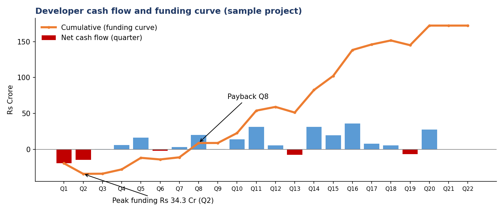
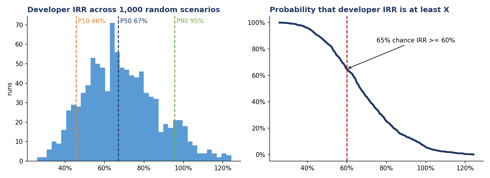
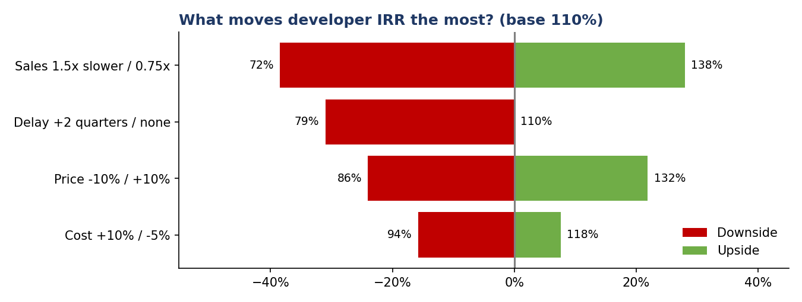

# Real Estate Feasibility Engine


An **adaptive feasibility model for real estate development projects** (villas, apartments, plots, commercial and mixed use), built first in Excel and then rebuilt as a Python web app.

Change the project duration, a payment plan or the product mix, and the whole model (timeline, customer collections, costs, cash flow, IRR and risk analysis) updates by itself. No quarter-by-quarter retyping.

### ▶ Live app: **https://real-estate-feasibility.streamlit.app**

> **Disclaimer:** "Project Aurora" is a fictional sample project with illustrative numbers. Tax, stamp duty, BAR and other regulatory rates are placeholders that must be verified before any real use. Nothing here is investment advice.

---

## The problem this solves

In a typical Excel feasibility model, timing is typed by hand: each cost has a row of percentages for every quarter, and customer payment plans are tied to fixed quarters.

So when something changes (construction takes 6 years instead of 4, the payment plan gets more floors, a launch slips by two quarters), many sheets need to be fixed manually, and every manual fix is a chance for an error.

This project replaces typed timing with **rules**:

| Instead of typing… | You describe… |
|---|---|
| 12 % values, one per quarter, for construction spend | "S-curve over 16 quarters" |
| "Slab casting due in Q9" | "Slab casting due when construction reaches 35%" |
| A launch quarter for every product | "Apartments launch 1 quarter after the villas" |

The engine turns those rules into quarter-by-quarter numbers, and every row is checked to add up to exactly 100%.

---

## What the app does

| Screen | What you get |
|---|---|
| **0 · Dashboard** | 12 KPI cards coloured against your benchmarks, 6 takeaways written automatically from the numbers, 7 interactive charts |
| **S · Stress & Monte Carlo** | Live sliders (price, construction cost, sales speed, delay), scenario comparison, tornado chart, heat maps, headroom, and a Monte Carlo simulation with probabilities |
| **1 to 8 · Inputs** | Forms and editable tables for project, land, scenarios, zones, products, product timing links, 21 cost heads, calculators (BAR, AIF, initial investment), payment plans, tax and benchmarks |
| **9 · Checks & summary** | Every input problem in plain English, shown next to the field or row that caused it |
| **Sidebar** | Save / open a project file, and a one-click **Excel report** (8 sheets) that anyone can read without the app |

### Sample results (Project Aurora, base case, JV deal)

| Metric | Value |
|---|---|
| Gross development value | ₹803 Cr |
| EBITDA / PAT | ₹172.4 Cr (21.5%) / ₹127.6 Cr (15.9%) |
| Developer IRR (pre-tax) | 110.2% |
| Peak investment | ₹34.3 Cr in Q2, recovered by Q8 |
| Headroom | Sales prices can fall 32.8% before developer IRR drops to the 18% hurdle |
| Monte Carlo (1,000 runs) | P10 / P50 / P90 developer IRR of 46% / 67% / 95%; 65% chance IRR is at least 60% |







**One insight worth noting:** sales speed and delays move developer IRR more than price or construction cost. In a project largely funded by customer pre-sales, *when* the cash arrives matters more than *how much* it is. Profit barely changes; IRR changes a lot.

---

## How the engine works

Every result flows through the same chain, mirroring the sheets of the Excel model:

```
inputs  ->  timeline  ->  curves  ->  collections  ->  costs  ->  cash flow  ->  report / stress / export
```

| Step | File | In simple words |
|---|---|---|
| Inputs | `engine/inputs.py` | One structured "form" per input section, saving and loading projects, and every input check with a plain-English message |
| Timeline | `engine/timeline.py` | **When** things happen: 40 quarter dates, Indian financial years, each product's launch / sales / construction quarters, links between products, project phases |
| Curves | `engine/curves.py` | **How much per quarter**: Upfront, Even, Front-loaded, Back-loaded and S-curve shapes, each always totalling exactly 100% |
| Collections | `engine/collections.py` | Bookings turned into cash: booking-linked and construction-linked payment-plan milestones, catch-up payments by late buyers, the landowner's revenue share |
| Costs | `engine/costs.py` | All 21 cost heads plus land, stamp duty, brokerage, BAR / premium FAR, AIF interest and the initial investment |
| Cash flow | `engine/cashflow.py` | Outflows by cost head, landowner advance and recovery, project and developer cash flow, P&L, IRR, NPV, peak investment, payback and 18 key metrics |
| Report | `engine/report.py` | KPI cards and the auto-written takeaways |
| Stress | `engine/stress.py` | Levers, scenario comparison, sensitivities, heat maps, headroom, Monte Carlo |
| Export | `engine/export.py` | The 8-sheet Excel report, and reopening a report as a project |

### A few rules worth knowing

- **Construction-linked payments.** A milestone like "first floor roof at 35%" falls due in the quarter the product's cumulative construction progress crosses 35%. Buyers who booked earlier pay it then; buyers who book later pay it as a catch-up shortly after booking.
- **Landowner (JV) payments.** The advance is paid first. The landowner then receives nothing more until his share of collections exceeds the advance, so the advance is recovered automatically.
- **No double counting.** Items paid early as part of the initial investment (stamp duty, brokerage, legal, part of BAR) are taken out of their cost head's normal spending curve.
- **IRR** is calculated on quarterly cash flows and annualised as (1 + quarterly IRR) to the power 4, minus 1.

---

## How it was verified

The Python engine was built to reproduce the Excel model exactly, then protected with an automated test suite.

- **Matches the Excel model** to about 0.0000000000001 in every quarter of every row: product timing, curves, collections, all 21 cost amounts, every cash-flow row, the P&L, all 18 key metrics and the full Excel stress sheet.
- **Two independent methods for collections** (fast formula vs following every group of buyers quarter by quarter) agree in 8 different situations.
- **Accounting identities hold in 54 combinations** of scenario, deal type, project type and catch-up rule: developer cash equals EBITDA, every cost is paid exactly once, the landowner receives exactly his share.
- **170 automated tests** run in about 20 seconds. Planting a 1% error in a single formula makes 92 of them fail.

Run them yourself:

```
pip install -r requirements.txt pytest
python -m pytest tests -q
```

---

## Run it yourself

**Option 1: just use the live app** (link at the top).

**Option 2: on your computer**

```
pip install -r requirements.txt
streamlit run app.py
```

**Option 3: in Google Colab, no installation.** Open the notebooks in the `notebooks` folder in order (Step 1 to Step 9). Each one explains and builds one part of the engine, compares it with the Excel model, and the later ones open the app.

---

## Repository layout

```
app.py              the Streamlit app (input screens, sidebar, navigation)
dashboard.py        dashboard screen and charts
stress_view.py      stress testing and Monte Carlo screen
engine/             the calculation engine (no screens, fully testable)
tests/              170 automated tests
data/               sample project file and the Excel model used by the comparison tests
docs/               the Excel model, its user guide and a sample Excel report
notebooks/          step-by-step build notebooks for Google Colab (Steps 1 to 9)
images/             charts used in this README
```

---

## Limitations

- Sample project with illustrative inputs; all regulatory and tax rates must be confirmed for a real deal.
- The model horizon is 40 quarters (10 years).
- Post-tax IRR is indicative: tax is spread in line with collections rather than by revenue-recognition rules.
- No price escalation over time and no debt financing layer (equity cash flows only).

---

## Tech stack

Python (pandas, NumPy) · Streamlit · Plotly · openpyxl · pytest · Excel · Google Colab · Streamlit Community Cloud

## Author

**Aditya Kumar Tiwari**
[LinkedIn](https://www.linkedin.com/in/aditya-tiwari-3a947a25b) · [GitHub](https://github.com/aditya28-tech)

Feedback is very welcome, especially from people working in real estate development, feasibility or finance.
